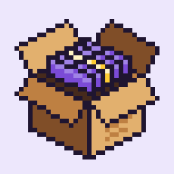
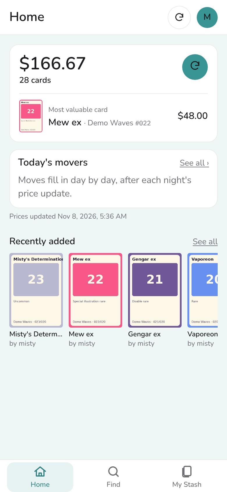
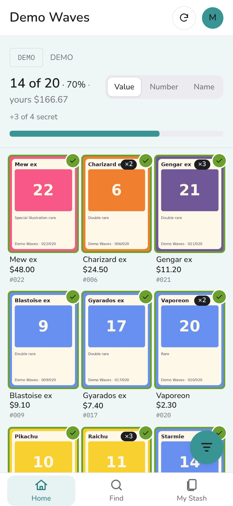
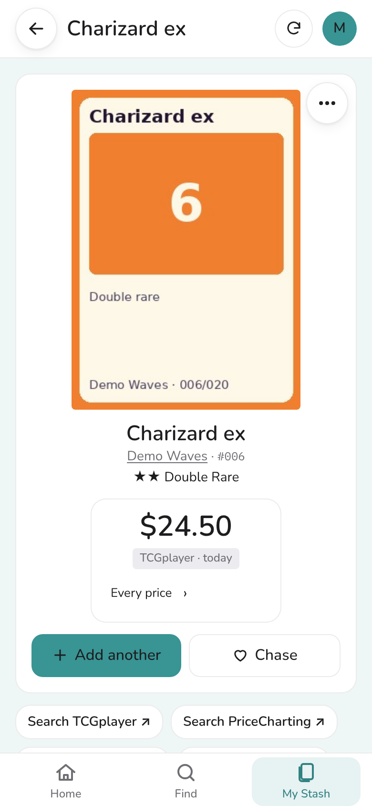
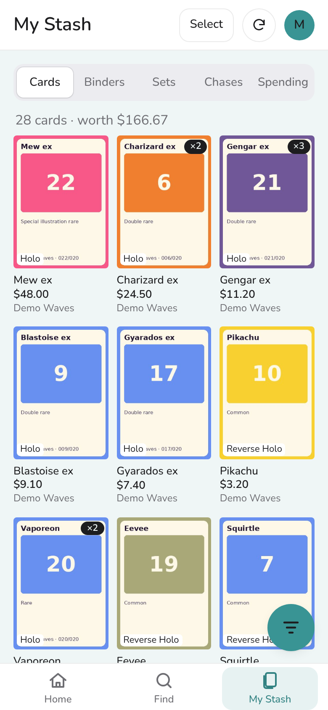

<p align="center"></p>

<h1 align="center">dexSTASH</h1>

<p align="center">A self-hosted Pokémon card collection app for your phone. Track every set you're completing, find any card in every language grouped by its art, scan cards in batches or for a trade, and keep an eye on what your collection is worth, on your own server.</p>

<p align="center">
<a href="LICENSE"></a>
<a href="https://github.com/mags-ob/dexSTASH/releases/latest"></a>
</p>

<p align="center">
<picture><source media="(prefers-color-scheme: dark)" srcset="docs/screenshots/home-dark.png"></picture>
<picture><source media="(prefers-color-scheme: dark)" srcset="docs/screenshots/set-dark.png"></picture>
<picture><source media="(prefers-color-scheme: dark)" srcset="docs/screenshots/card-dark.png"></picture>
<picture><source media="(prefers-color-scheme: dark)" srcset="docs/screenshots/my-stash-dark.png"></picture>
</p>

<p align="center"><sub>Screenshots use the made-up demo set from <code>tools/demo_data.py</code>, not real card art. They follow your GitHub theme, light or dark.</sub></p>

## Features

- **Set completion:** how much of each set you have, secret rares counted apart.
- **Find any card** in every language TCGdex covers, by name or by describing the Pokémon. The same art in English, Japanese and Chinese shows once.
- **Scan cards** in batches with your phone's camera.
- **Trade:** scan your cards and theirs, compare each side's total, and finish the trade to update your stash.
- **Prices** from TCGplayer, CardTrader and PriceCharting, averaged, with history and top movers.
- **Binders and chases:** binders you can share, chases, conditions, spending and pack pulls, with shared logins.
- **Nightly jobs:** backups and price updates run on their own.

## What you need

- A computer, NAS or small server with Docker and Docker Compose (amd64 or arm64).
- About 0.5 GB of memory, or about 2 GB with scanning on.
- A domain name and HTTPS, so phones can sign in and use the camera. The setup guide shows how, including a free DuckDNS name and a bundled Caddy.

## Quick start

On your server:

```sh
mkdir dexstash && cd dexstash
curl -fsSLO https://raw.githubusercontent.com/mags-ob/dexSTASH/main/docker-compose.yml
curl -fsSL -o .env https://raw.githubusercontent.com/mags-ob/dexSTASH/main/.env.example
```

**If you already run a reverse proxy in Docker** (Caddy, Nginx, Traefik): in `.env`, set `DEXSTASH_NETWORK` to the Docker network your proxy is on and `DEXSTASH_NETWORK_EXTERNAL=true`, point your domain at `dexstash:8000`, then start it:

```sh
docker compose up -d
```

**If you don't,** use the bundled Caddy. Your domain must point at your server, with ports 80 and 443 forwarded to it. Set `DEXSTASH_DOMAIN` in `.env`, then:

```sh
mkdir deploy && curl -fsSL -o deploy/Caddyfile https://raw.githubusercontent.com/mags-ob/dexSTASH/main/deploy/Caddyfile
docker compose --profile caddy up -d
```

Open your domain. The first visit asks for a one-time setup code, which is in the app's log (`docker logs dexstash`), and then a short setup wizard runs.

**The full setup guide is [docs/deploy.md](docs/deploy.md):** every step, HTTPS, scanning, backups and updating.

## Where data comes from

The app downloads card data and prices into your own `data/` folder while it runs; none of it is in this repository. [NOTICE.md](NOTICE.md) credits each source and its terms.

| Source | What it gives | On? |
| --- | --- | --- |
| [TCGdex](https://tcgdex.dev) | Sets, cards and card pictures | Always on |
| [PokéAPI](https://pokeapi.co) | Pokémon names, types and sprites | Always on |
| [TCGCSV](https://tcgcsv.com) | TCGplayer's daily prices | On, can be turned off |
| [European Central Bank](https://www.ecb.europa.eu) | Exchange rates | On, can be turned off |
| [CardTrader](https://www.cardtrader.com/docs/api/full/reference) and [PriceCharting](https://www.pricecharting.com/api-documentation) | More prices | Optional, with your own API key |
| Limitless TCG | Japanese card pictures TCGdex lacks | Optional |
| [PTCG-CHS-Datasets](https://github.com/duanxr/PTCG-CHS-Datasets) and [PTCG-card-data](https://github.com/zsjy947/PTCG-card-data) | Mainland Chinese cards | Optional |
| [Bulbapedia](https://bulbapedia.bulbagarden.net) | Pokémon descriptions for Describe search | Optional |
| CLIP picture model | Enhanced Search and scanning | Optional |

Optional sources are off until an admin turns them on or downloads them in the app. API keys go in Data sources › Prices › API keys.

## Guides

- [Setup](docs/deploy.md): installing on your server, step by step.
- [Configuration](docs/configuration.md): every setting in `.env` and in the app.
- [Updating](docs/updating.md): getting a new version, and going back.
- [Backups and moving servers](docs/backups.md)
- [Scanning](docs/scanning.md): the ways to run the scanner.

## Development

```sh
python3 -m venv .venv && . .venv/bin/activate
pip install -r requirements/requirements.lock pytest
python -m pytest -q                              # the whole suite; no network needed
DEXSTASH_HTTPS_ONLY=0 uvicorn app.main:app --reload
```

- `tools/demo_data.py` fills an empty data folder with a made-up set and collection (sign in as `misty` / `pikachu123`). It's how the screenshots were made.
- `tools/make_logo.py` draws the logo and app icons.
- `tools/make_diagrams.py` draws the two architecture diagrams.
- [docs/architecture.md](docs/architecture.md) explains how the app fits together, with diagrams and a map from each page to its code and tables.
- [docs/specs/](docs/specs/README.md) holds a spec for each part of the app: what it does and what a change must keep true.
- [AGENTS.md](AGENTS.md) is for anyone working with an AI coding assistant.

The app is FastAPI with Jinja templates and htmx, and SQLite. There's no JavaScript build step.

### Building from source

```sh
git clone https://github.com/mags-ob/dexSTASH.git dexstash
cd dexstash
cp .env.example .env
docker compose up -d --build
```

The rest of [Quick start](#quick-start) is the same. To update, `git pull` and run `docker compose up -d --build` again.

## Getting help

- **Questions and ideas:** [GitHub Discussions](https://github.com/mags-ob/dexSTASH/discussions).
- **Something broken:** [open an issue](https://github.com/mags-ob/dexSTASH/issues/new/choose); the form asks for your version and what you saw.
- **A security problem:** don't open an issue; [SECURITY.md](.github/SECURITY.md) says how to report it privately.

## Contributing, security and licence

- [CONTRIBUTING.md](.github/CONTRIBUTING.md): running the tests and the code style.
- [docs/lifecycle.md](docs/lifecycle.md): how a change moves from an issue to a release.
- [SECURITY.md](.github/SECURITY.md): how to report a security problem privately.
- [CHANGELOG.md](CHANGELOG.md): what changed in each version.

dexSTASH is free software under the [GNU Affero General Public License v3.0](LICENSE). If you run a changed copy for other people, offer them your changes too. Card data, pictures, sprites, prices and models come from other sources under their own terms; see [NOTICE.md](NOTICE.md).

dexSTASH is a fan project. It is not affiliated with, endorsed by or sponsored by Nintendo, Creatures Inc., GAME FREAK inc. or The Pokémon Company.

## Use of AI

dexSTASH is built and maintained with Anthropic's Claude.

- **Code:** Claude writes most of the code, tests and docs; the designer reviews every change before it's merged.
- **Process:** each change is an issue that moves through Define, Build, Validate and Done ([docs/lifecycle.md](docs/lifecycle.md)). The designer approves the plan before any code and the pull request before it's merged, to keep the app accurate and stable.
- **Rules:** [AGENTS.md](AGENTS.md) and [rules/](rules/) keep personal details, secrets and unlicensed data out, and keep the code consistent.
- **In the app:** nothing is sent to an AI service; scanning runs on your own server.
