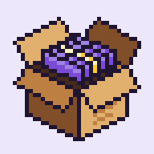
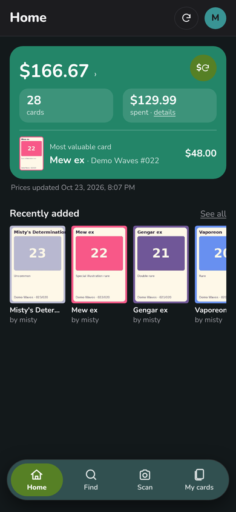
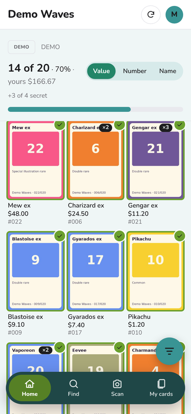
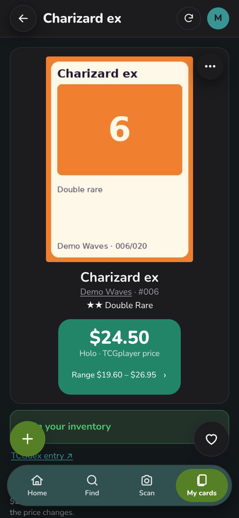
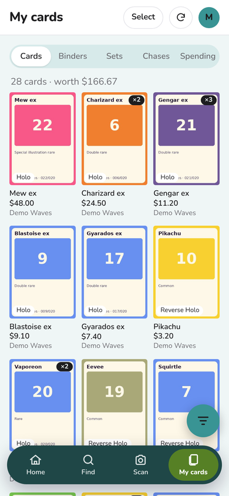

<p align="center"></p>

<h1 align="center">dexSTASH</h1>

<p align="center">A self-hosted Pokémon card collection app for your phone. Track every set you're completing, scan cards in batches, and keep an eye on what your collection is worth, on your own server.</p>

<p align="center">
<a href="LICENSE"></a>
<a href="CHANGELOG.md"></a>
<a href="https://github.com/obiehq/dexSTASH/actions/workflows/tests.yml"></a>
</p>

<p align="center">




</p>

<p align="center"><sub>Screenshots use the made-up demo set from <code>tools/demo_data.py</code>, not real card art.</sub></p>

## Features

- **Set completion.** Every set shows how many of its cards you have ("14 of 20"), with secret rares counted apart, sorted by value, number or name.
- **Find any card** in English, Japanese, Korean, Chinese and the other languages TCGdex covers. Type a name in English and it searches in the card's language too. "Don't know the name?" finds a Pokémon by type, colour or a few words. After the first search in a language, Find searches a copy of the card list kept on your own server.
- **Scan cards in batches.** Take photos with the phone's camera. The server reads the name, set code and number (RapidOCR, CPU only) and matches each photo to a card. You review the batch and add it in one go. The optional Enhanced Search matches a photo by its picture when the text can't settle it.
- **Prices.** TCGplayer's market price for every card (through TCGCSV), CardTrader's lowest listing with your own API token, and any price you type in. Every source counts: the card page shows the range from lowest to highest and lists each one, and lists, sorting, your stash's worth and price history use their average. A daily value-over-time chart and top movers. Links you save to other sites open in your browser; dexSTASH never reads them.
- **Your collection, your way.** Printings and conditions, binders (shareable with friends through a link and a code), chases, spending and pack pulls, notes, and where each card came from.
- **Shared accounts.** Several logins on one collection, with who added what.
- **Collectr CSV import** with a queue for rows that need a decision, and **CSV downloads** of your stash, a binder or your chases (dexSTASH's own columns or Collectr's).
- **Pokémon colour themes**, light and dark, with WCAG-checked contrast.
- **A first-run wizard** that sets the basics and starts the downloads you pick, with their sizes, then a Getting started list on Home.
- **Looks after itself.** It backs up before every upgrade and every night, keeps an activity log you can read on your phone, and updates prices nightly.
- **Your time zone and currency.** At each price update every price is converted at the European Central Bank's daily rate and saved in US dollars and in your currency, with the rate used, so a price never changes while you look at it and the history keeps what it was worth that day.

## What you need

- A computer, NAS or small server that runs Docker with Compose (amd64 or arm64).
- **Without scanning** (the default): give it about 0.5 GB of memory. It uses about 120 MB most of the time, about half a CPU and about 1 GB of storage; the number of cards barely matters.
- **With scanning:** about 2 GB of memory in all. Reading photos and Enhanced Search peak at 1.5 to 2 GB, and the models and picture fingerprints take 2 to 3 GB of storage. [The scanner](#scanning) has the three ways to run it.
- To use it away from home: a domain name and a reverse proxy that serves HTTPS, such as Caddy. A phone's camera only works on an HTTPS page.

## Quick start

```sh
git clone https://github.com/obiehq/dexSTASH.git dexstash
cd dexstash
cp .env.example .env
```

To try it on the same computer first, open `docker-compose.yml` and uncomment the two `ports:` lines under `app`, then set `DEXSTASH_HTTPS_ONLY=0` in `.env`. Then:

```sh
docker compose up -d --build
docker compose ps        # dexstash says (healthy) after about 20 seconds
docker logs dexstash     # shows the one-time setup code
```

Open http://localhost:8000, type the setup code and create the first admin account. The code is also in `data/setup-code.txt` until the first account exists. On a hosting service where you can't read logs or files, set `DEXSTASH_ADMIN_USER` and `DEXSTASH_ADMIN_PASSWORD` before the first start instead, then remove the password once you've signed in.

After signing in, a short first-run wizard asks you to change your password, then sets the time zone and currency, the languages you collect and the extra sites, and what to download (each with its estimated size). Everything it sets is in Account and Data sources afterwards.

When you put it online, comment the `ports:` lines out again and set `DEXSTASH_HTTPS_ONLY=1`.

## Putting it online with HTTPS

The app listens on port 8000 inside its container and isn't published to your network, so only your reverse proxy reaches it. With Caddy in Docker, put dexSTASH on Caddy's network by adding this to `.env` (`docker network ls` shows the name):

```
DEXSTASH_NETWORK=<your Caddy network>
DEXSTASH_NETWORK_EXTERNAL=true
```

Then add a site to your Caddyfile and reload Caddy:

```
cards.example.com {
    reverse_proxy dexstash:8000
    encode gzip
    request_body {
        max_size 25MB
    }
}
```

`request_body` lets scan photos upload. No Caddy yet? `docker compose --profile caddy up -d` starts one from this folder, using `DEXSTASH_DOMAIN` from `.env`. [DEPLOY.md](DEPLOY.md) has the full steps, including a free DuckDNS domain and Caddy running outside Docker.

On a phone, open your address in Safari or Chrome and choose **Add to Home Screen** (Account has the steps). It opens full screen like an app, with its own launch screen and, when the server can't be reached, a page that says so and tries again. This needs https: over plain http the phone saves a bookmark instead.

## Configuration

Everything in `.env` is optional; `.env.example` has each one with a note.

| Setting | Default | What it does |
|---|---|---|
| `APP_NAME` | `dexSTASH` | The name shown in the app, the browser tab and shared binders. |
| `DEXSTASH_SECRET_KEY` | made on first start | Signs sign-ins and shared-binder codes. Left empty, the app makes one in `data/secret_key`. If you set one, it must be at least 32 characters. |
| `DEXSTASH_ADMIN_USER`, `DEXSTASH_ADMIN_PASSWORD` | unset | Creates the first admin on the first start instead of asking for the setup code. Only read while there are no accounts. |
| `DEXSTASH_HTTPS_ONLY` | `1` | `1` sends the sign-in cookie only over HTTPS. Set `0` only to try it over plain http. |
| `DEXSTASH_PROXY_IPS` | private addresses | The addresses of your reverse proxy. The app believes the visitor's address and https from these only, so wrong-password lockouts block the right visitor and the sign-in cookie is marked secure. |
| `DEXSTASH_SCANNER` | unset | `off`, `inside` or `separate`: see [Scanning](#scanning). Unset, the Scanning switch in Data sources decides. |
| `COMPOSE_PROFILES` | unset | `scanner` starts the separate scanner container with every `docker compose` command. |
| `DEXSTASH_NETWORK`, `DEXSTASH_NETWORK_EXTERNAL` | `dexstash`, `false` | The Docker network the app joins, so a Caddy in Docker can reach `dexstash:8000`. |
| `PUID`, `PGID` | `1000` | The owner of the files in `data/` (run `id` to see yours). |
| `TZ` or `DISPLAY_TZ` | `Etc/UTC` | Your time zone. Only read on the first start; after that, change it in the app. |
| `DEXSTASH_TCGCSV` | `1` | `0` turns off TCGCSV's daily TCGplayer prices. |
| `DEXSTASH_CARD_INDEX` | `1` | `0` turns off the local card catalog: Find then asks TCGdex for every search, as before 0.15.3. |
| `DEXSTASH_EURO_RATE` | `1` | `0` turns off the ECB exchange rates (prices in other currencies, CardTrader's and typed ones, then aren't converted). |
| `DEXSTASH_PICTURE_CHECK` | `1` | `0` stops the background picture check altogether. |
| `DEXSTASH_TCGDEX_CACHE` | `1` | `0` stops keeping TCGdex replies for a week. |
| `DEXSTASH_PICTURE_MODEL_URL` | Jina's copy | Where Enhanced Search downloads its model from. |
| `DEXSTASH_DOMAIN`, `HTTP_PORT`, `HTTPS_PORT` | | Only for the bundled Caddy (`--profile caddy`). |
| `DUCKDNS_SUBDOMAIN`, `DUCKDNS_TOKEN` | | Only for the bundled DuckDNS updater (`--profile duckdns`). |

A setting written with another prefix (for example a typo) is named in the log at start, with the name it needs.

**In the app** (Account › Data sources, admins only): time zone, currency, the nightly price update's time, how long price history is kept, the price and picture site switches, Enhanced Search, and the downloads (sprites, Chinese sets, Pokémon descriptions). Each login picks its own theme and light or dark mode under Account.

## Where your data comes from

**dexSTASH is your notebook.** It reads a few open sources for the card catalogue and everyday prices: TCGdex, TCGCSV, the European Central Bank and PokéAPI, plus CardTrader's official API if you give it a token. Any other site is a link **you** add to a card, like a note in the margin: dexSTASH saves it and opens it, and never reads the page. A price you see there can be typed in beside the link. A few picture and data sites have a switch under Data sources › Price and picture sites; a new install starts with every one off, and turning one off never deletes anything.

Every request names itself with the User-Agent `dexSTASH/<version> (+https://github.com/obiehq/dexSTASH)`.

| Source | What dexSTASH takes from it | When | Terms | New installs |
|---|---|---|---|---|
| [TCGdex](https://tcgdex.dev) | Sets, cards, card pictures, TCGplayer prices for printings TCGCSV doesn't have | Browsing and searching; Find's card catalog fetches each set of a language once (one request a second), then new sets nightly | Open-source API built for apps like this; card art © its owners | Always on |
| [TCGCSV](https://tcgcsv.com) | TCGplayer's daily prices and product ids | Nightly update | Free daily copy of TCGplayer's price data | Always on (`DEXSTASH_TCGCSV`) |
| [European Central Bank](https://www.ecb.europa.eu) | Daily exchange rates | Once a day | Free reuse with the source named | Always on (`DEXSTASH_EURO_RATE`) |
| [PokéAPI](https://pokeapi.co) | Pokémon names in every language, types, colours, Pokédex text; sprites for themes | Downloaded once into `data/` | BSD data; sprites and Pokédex text © Nintendo / GAME FREAK | Always on (sprites when an admin presses Download) |
| CLIP model (via Jina's clip-as-service) | The Enhanced Search picture model | Once, when you turn Enhanced Search on | MIT | Off until turned on |
| [CardTrader API](https://www.cardtrader.com/docs/api/full/reference) | Each kept card's lowest listing, through CardTrader's official API | Nightly update, one request a second | CardTrader's API terms; your own token | Only with a token in Data sources › Prices › API keys |
| [PriceCharting API](https://www.pricecharting.com/api-documentation) | Each kept card's ungraded price, through PriceCharting's official API | Price updates: a search once a week, a price once a day, one request a second | PriceCharting's API terms; your own paid token | Only with a token in Data sources › Prices › API keys |
| TCGplayer and PriceCharting pages | Nothing is read. Search buttons and the links you paste open in your browser; TCGplayer's product pictures come from TCGCSV's product list | When you tap | Each site's terms | Links only |
| eBay | Nothing is read. "Search eBay sold" opens the card's sold, ungraded listings on the eBay site picked in Data sources › Settings, with no tracking | When you tap | eBay's terms | Links only |
| Limitless TCG | Japanese card pictures TCGdex doesn't have | When a card is shown or saved | Limitless's terms | **Off** (switch) |
| [PTCG-CHS-Datasets](https://github.com/duanxr/PTCG-CHS-Datasets) and [PTCG-card-data](https://github.com/zsjy947/PTCG-card-data) | Mainland Chinese sets, pictures and their English names | When an admin presses Load | Personal, non-commercial use only; PTCG-card-data is CC0 | **Off** (switch) |
| [Bulbapedia](https://bulbapedia.bulbagarden.net) | Pokémon "Origin" text for Describe search | When an admin presses Download, one page a second | CC BY-NC-SA, personal use | **Off** (switch) |

**Nothing from these sources is stored in this repository.** Pictures, sprites, prices, descriptions, Chinese data and models are downloaded into your own `data/` folder while the app runs. [NOTICE.md](NOTICE.md) and Account › About credit each one.

## Updating

```sh
git pull                       # or unpack a new release over the old files
docker compose up -d --build
```

Each release on GitHub also carries the image ready-built (one file for amd64, one for arm64), so a server can load it instead of building: see DEPLOY.md › Using a release image.

- **Everything the app keeps is in `data/`** (on a hosting service, the data folder or volume, often `/srv/data` or `/app/data`). `.env` and `data/` are kept by an update.
- **Updates only go forward.** On start, the app backs up the database into `data/backups/` and then updates its tables. An older version refuses to start on an updated database and says so in its log.
- **To go back,** stop the app, put the backup made before the update (`data/backups/…-upgrade.db`) in place of `data/dexstash.db`, then install the older version. [DEPLOY.md](DEPLOY.md) has the commands. Restoring it from Account › Backups doesn't work for this, because the newer version updates it again.
- **Before a big update,** press Account › Backups › **Back up now** and **Download photos**, and keep both somewhere else.

[CHANGELOG.md](CHANGELOG.md) lists what each version changes.

## Backups and moving servers

Everything dexSTASH knows is in `data/`: the database (`dexstash.db`), its backups, your card photos, downloaded pictures and models. Card data and prices downloaded from TCGdex, TCGCSV and CardTrader (and, since 0.15.3, the card catalog Find searches) are in a file of their own, `dexstash-catalog.db`, so backups hold only what's yours; if that file is lost or damaged, Data sources › Prices › ⋯ › **Rebuild downloaded data** fetches it again. The app copies the database into `data/backups/` before every upgrade, every night, and when an admin presses **Back up now**; Account › Backups restores or downloads them. Your own card photos aren't in those copies: **Download photos** saves them as one zip.

To move to another server, stop the app and copy the whole folder, `data/` and `.env` included. `data/secret_key` keeps everyone signed in and shared-binder codes working. It's also worth having your server back up that folder to another drive.

## Scanning

Reading scan photos and Enhanced Search need about 1.5 GB of memory more than the app. Without `DEXSTASH_SCANNER` in `.env`, an admin turns scanning on or off under Account › Data sources › Scanning (Off to start; On runs it `inside`, and the Scan tab only shows while it's on). Setting `DEXSTASH_SCANNER` in `.env` fixes it instead, and the switch then says "Set in .env":

| `DEXSTASH_SCANNER` | Containers | Memory | Good for |
|---|---|---|---|
| `off` | One | about 0.5 GB | Typing cards in, importing from Collectr, small hosting plans. Photos aren't read, and Data sources says so. |
| `inside` | One | about 2 GB | Hosting services that run one container. The photo reader runs inside the app's container at the lowest priority, so pages and searches come first; it's restarted if it stops, and isn't started at all under 1.5 GB. |
| `separate` | Two | about 2 GB in all | Your own server. `dexstash-scanner` reads photos in a container of its own with its own memory and CPU limits (in `docker-compose.yml`), so a big batch can never slow the pages. |

The app container's memory cap is 2 GB by default, so `inside` works with no change (`DEXSTASH_APP_MEMORY` in `.env` lowers it on a small host). Scanning works out English, Japanese and Chinese (mainland and Taiwan) cards on its own. For Korean cards, tap the photo's language tag and pick KO.

For `separate`, also set `COMPOSE_PROFILES=scanner` in `.env` (or start it with `docker compose --profile scanner up -d`). Both containers share `data/`. The scanner's photo reader and picture model only load while there's work and let go when idle. `external` and `inline`, the names before 0.15.2, still work.

## Development

```sh
python3 -m venv .venv && . .venv/bin/activate
pip install -r requirements.txt pytest
python -m pytest
DEXSTASH_HTTPS_ONLY=0 uvicorn app.main:app --reload
```

- `tools/demo_data.py` fills an empty data folder with a made-up set and collection (sign in as `misty` / `pikachu123`). It's how the screenshots were made.
- `tools/make_logo.py` draws the logo and app icons.
- [docs/architecture.md](docs/architecture.md) explains how the app fits together, with diagrams and a map from each page to its code and tables.

The app is FastAPI with Jinja templates and htmx, and SQLite. There's no JavaScript build step.

## Contributing, security and licence

- [CONTRIBUTING.md](CONTRIBUTING.md): running the tests and the code style.
- [SECURITY.md](SECURITY.md): how to report a security problem privately.
- [CHANGELOG.md](CHANGELOG.md): what changed in each version.

dexSTASH is free software under the [GNU Affero General Public License v3.0](LICENSE). If you run a changed copy for other people, offer them your changes too. Card data, pictures, sprites, prices and models come from other sources under their own terms; see [NOTICE.md](NOTICE.md).

dexSTASH is a fan project. It is not affiliated with, endorsed by or sponsored by Nintendo, Creatures Inc., GAME FREAK inc. or The Pokémon Company.
