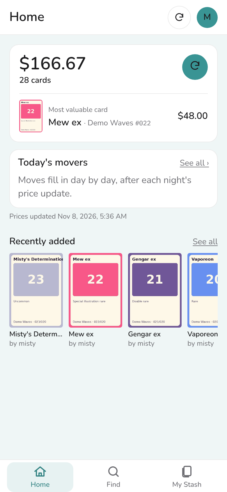
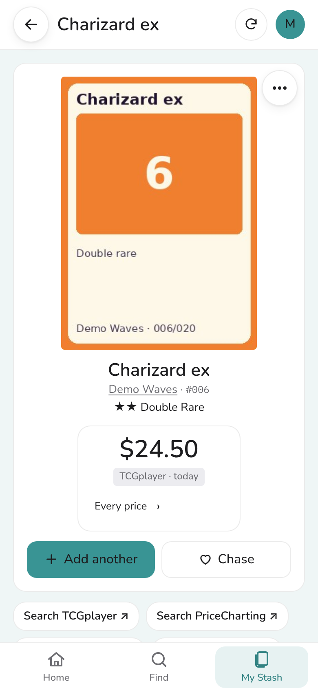
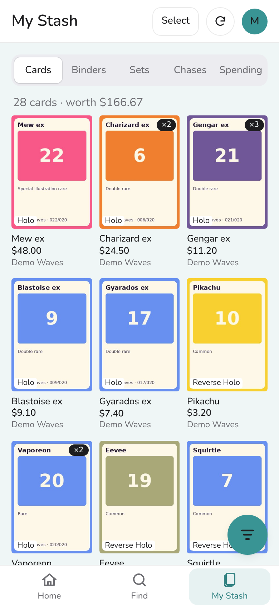

<p align="center"></p>

<h1 align="center">dexSTASH</h1>

<p align="center">A self-hosted Pokémon card collection app for your phone. Track every set you're completing, scan cards in batches, and keep an eye on what your collection is worth, on your own server.</p>

<p align="center">
<a href="LICENSE"></a>
<a href="CHANGELOG.md"></a>
<a href="https://github.com/obiehq/dexSTASH/actions/workflows/tests.yml"></a>
</p>

<p align="center">
<picture><source media="(prefers-color-scheme: dark)" srcset="docs/screenshots/home-dark.png"></picture>
<picture><source media="(prefers-color-scheme: dark)" srcset="docs/screenshots/set-dark.png"></picture>
<picture><source media="(prefers-color-scheme: dark)" srcset="docs/screenshots/card-dark.png"></picture>
<picture><source media="(prefers-color-scheme: dark)" srcset="docs/screenshots/my-stash-dark.png"></picture>
</p>

<p align="center"><sub>Screenshots use the made-up demo set from <code>tools/demo_data.py</code>, not real card art. They follow your GitHub theme, light or dark.</sub></p>

## Features

- **Set completion:** see how much of each set you have, with secret rares counted apart.
- **Find any card** in English, Japanese, Chinese, Korean and the other languages TCGdex covers, by name or by describing the Pokémon.
- **Scan cards in batches** with your phone's camera; the server reads and matches each photo.
- **Prices** from TCGplayer (through TCGCSV), CardTrader and PriceCharting (with your own API keys) and your own, averaged, with history and top movers.
- **Your collection, your way:** printings, conditions, binders you can share, chases, spending and pack pulls.
- **Shared logins** on one collection, with who added what.
- **Import and export:** Collectr CSV import, and CSV downloads of your stash, binders and chases.
- **Looks after itself:** nightly backups and price updates, and an activity log you can read on your phone.
- **Your currency and time zone,** and Pokémon colour themes in light and dark.

## What you need

- A computer, NAS or small server that runs Docker with Compose (amd64 or arm64).
- **Without scanning** (the default): give it about 0.5 GB of memory. It uses about 120 MB most of the time, about half a CPU and about 1 GB of storage; the number of cards barely matters.
- **With scanning:** about 2 GB of memory in all. Reading photos and Enhanced Search peak at 1.5 to 2 GB, and the models and picture fingerprints take 2 to 3 GB of storage. [Scanning](docs/scanning.md) has the three ways to run it.
- To use it away from home: a domain name and a reverse proxy that serves HTTPS, such as Caddy. A phone's camera only works on an HTTPS page.

## Quick start

dexSTASH runs in Docker. It comes as a ready-built image (`ghcr.io/obiehq/dexstash`, amd64 and arm64), so you only need the compose file and, if you want to change a setting, a `.env` file:

```sh
mkdir dexstash && cd dexstash
curl -fsSLO https://raw.githubusercontent.com/obiehq/dexSTASH/main/docker-compose.yml
curl -fsSL -o .env https://raw.githubusercontent.com/obiehq/dexSTASH/main/.env.example
docker compose up -d
```

[Configuration](docs/configuration.md) lists every setting in `.env`.

The app doesn't publish a port of its own. It's meant to sit behind a reverse proxy that serves HTTPS, such as [Caddy](https://caddyserver.com), because a phone's camera only works on an HTTPS page. [DEPLOY.md](DEPLOY.md) has the full steps: the proxy, trying it on your own computer first, and the first sign-in, after which a short wizard sets the rest.

To build the image yourself instead, see [Building from source](#building-from-source).

## Where data comes from

dexSTASH uses a few open sources for the card catalogue and everyday prices, plus official APIs you give it a key for. A few picture and data sites have a switch under Data sources › Price and picture sites; a new install starts with each of them off, and turning one off never deletes anything. Every request names itself with the User-Agent `dexSTASH/<version> (+https://github.com/obiehq/dexSTASH)`.

### Always on

**[TCGdex](https://tcgdex.dev)**: sets, cards, card pictures, and TCGplayer prices for printings TCGCSV doesn't have.

- **When:** while you browse and search; Find's card catalog fetches each set of a language once, then new sets nightly.
- **Terms:** open-source API built for apps like this; card art © its owners.

**[TCGCSV](https://tcgcsv.com)**: TCGplayer's daily prices and product ids.

- **When:** in the nightly update. Turn off with `DEXSTASH_TCGCSV=0`.
- **Terms:** free daily copy of TCGplayer's price data.

**[European Central Bank](https://www.ecb.europa.eu)**: daily exchange rates.

- **When:** once a day. Turn off with `DEXSTASH_EURO_RATE=0`.
- **Terms:** free reuse with the source named.

**[PokéAPI](https://pokeapi.co)**: Pokémon names in every language, types, colours and Pokédex text; sprites for themes.

- **When:** downloaded once into `data/` (sprites when an admin presses Download).
- **Terms:** BSD data; sprites and Pokédex text © Nintendo / GAME FREAK.

**CLIP model** (Jina's clip-as-service copy): the Enhanced Search picture model.

- **When:** downloaded once, when you turn Enhanced Search on.
- **Terms:** MIT.

### With your own API key

Keys go in Data sources › Prices › API keys.

**[CardTrader API](https://www.cardtrader.com/docs/api/full/reference)**: each kept card's lowest listing.

- **When:** in the nightly update, one request a second.
- **Terms:** CardTrader's API terms.

**[PriceCharting API](https://www.pricecharting.com/api-documentation)**: each kept card's ungraded price (needs a paid plan).

- **When:** a search once a week and a price once a day, one request a second.
- **Terms:** PriceCharting's API terms.

### Switches, off on a new install

**Limitless TCG**: Japanese card pictures TCGdex doesn't have.

- **When:** a card is shown or saved.
- **Terms:** Limitless's terms.

**[PTCG-CHS-Datasets](https://github.com/duanxr/PTCG-CHS-Datasets) and [PTCG-card-data](https://github.com/zsjy947/PTCG-card-data)**: mainland Chinese sets, pictures and their English names.

- **When:** an admin presses Load.
- **Terms:** personal, non-commercial use only; PTCG-card-data is CC0.

**[Bulbapedia](https://bulbapedia.bulbagarden.net)**: Pokémon "Origin" text for Describe search.

- **When:** an admin presses Download, one page a second.
- **Terms:** CC BY-NC-SA, personal use.

### Links

Search buttons for TCGplayer, PriceCharting and eBay sold listings, and links you save on a card, open those sites in your browser. A price you see there can be typed in beside the link.

Data from these sources is downloaded into your own `data/` folder while the app runs; none of it is in this repository. [NOTICE.md](NOTICE.md) and Account › About credit each one.

## Guides

- [DEPLOY.md](DEPLOY.md): installing on your server, step by step, with Caddy and HTTPS.
- [Configuration](docs/configuration.md): every setting in `.env` and in the app.
- [Updating](docs/updating.md): getting a new version, and going back.
- [Backups and moving servers](docs/backups.md)
- [Scanning](docs/scanning.md): the three ways to run the scanner.

## Development

```sh
python3 -m venv .venv && . .venv/bin/activate
pip install -r requirements.lock pytest
python -m pytest -q                              # the whole suite; no network needed
DEXSTASH_HTTPS_ONLY=0 uvicorn app.main:app --reload
```

- `tools/demo_data.py` fills an empty data folder with a made-up set and collection (sign in as `misty` / `pikachu123`). It's how the screenshots were made.
- `tools/make_logo.py` draws the logo and app icons.
- `tools/make_diagrams.py` draws the two architecture diagrams.
- [docs/architecture.md](docs/architecture.md) explains how the app fits together, with diagrams and a map from each page to its code and tables.
- [docs/specs/](docs/specs/README.md) holds a spec for each part of the app: what it does and what a change must keep true.
- [AGENTS.md](AGENTS.md) is for anyone working with an AI coding assistant.

The app is FastAPI with Jinja templates and htmx, and SQLite. There's no JavaScript build step.

### Building from source

```sh
git clone https://github.com/obiehq/dexSTASH.git dexstash
cd dexstash
cp .env.example .env
docker compose up -d --build
```

The rest of [Quick start](#quick-start) is the same. To update, `git pull` and run `docker compose up -d --build` again.

## Getting help

- **Questions and ideas:** [GitHub Discussions](https://github.com/obiehq/dexSTASH/discussions).
- **Something broken:** [open an issue](https://github.com/obiehq/dexSTASH/issues/new/choose); the form asks for your version and what you saw.
- **A security problem:** don't open an issue; [SECURITY.md](SECURITY.md) says how to report it privately.

## Contributing, security and licence

- [CONTRIBUTING.md](CONTRIBUTING.md): running the tests and the code style.
- [SECURITY.md](SECURITY.md): how to report a security problem privately.
- [CHANGELOG.md](CHANGELOG.md): what changed in each version.

dexSTASH is free software under the [GNU Affero General Public License v3.0](LICENSE). If you run a changed copy for other people, offer them your changes too. Card data, pictures, sprites, prices and models come from other sources under their own terms; see [NOTICE.md](NOTICE.md).

dexSTASH is a fan project. It is not affiliated with, endorsed by or sponsored by Nintendo, Creatures Inc., GAME FREAK inc. or The Pokémon Company.

## Use of AI

dexSTASH is built with Anthropic's Claude, the only AI used in this project.

- **Code:** most of the code, tests and documentation is written by Claude, working from a GitHub issue and the spec for that part of the app. The project's designer reviews every pull request before it's merged, and the test suite, lint, rules check and secret scan run on each one.
- **Other work:** the project is run with a software development life cycle (SDLC) to keep the app accurate and stable. Each change starts as an issue with acceptance criteria and a spec, gets a written plan, is built and tested on its own branch, and is approved by the designer at each step. Claude helps turn requests into issues, write specs and plans, review changes, draft release notes, and make the screenshots and diagrams.
- **Rules:** [AGENTS.md](AGENTS.md) and [rules/](rules/) are the rules Claude follows here. They exist so AI-written work stays safe to publish and consistent with the rest of the app: they keep personal details and secrets out of the repository, allow only data sources whose terms permit it, and set how code is built, tested and documented. Some are checked automatically on every pull request.
- **In the app:** dexSTASH doesn't send anything to an AI service. Scanning reads photos with models that run on your own server (RapidOCR and the optional CLIP picture model).
